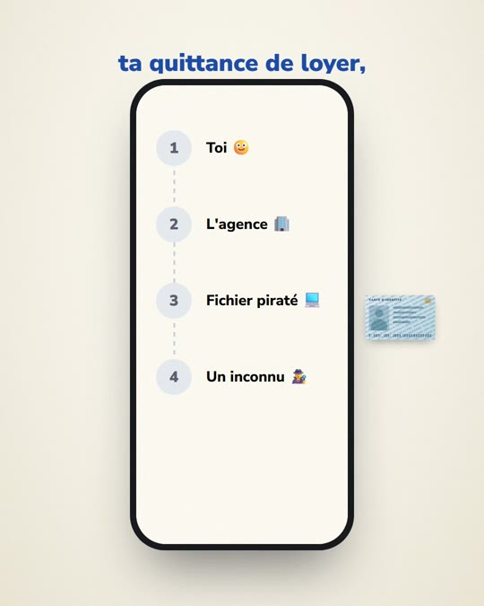
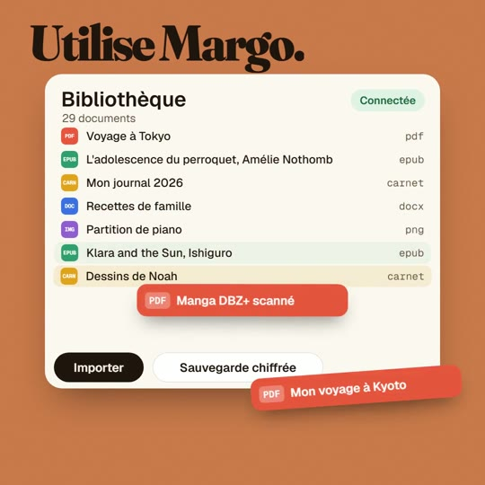

# Espace promo

Vidéos de présentation des logiciels d'**Anthony BELKACEM EI**, prêtes à publier sur LinkedIn.

Des logiciels simples, sans compte et sans cloud. Chaque vidéo renvoie vers l'application correspondante, diffusée sur GitHub.

| Logiciel | Dépôt public | Dernière version |
|---|---|---|
| Filigo | [Filigo-apps](https://github.com/Gitnmercury/Filigo-apps) | [Télécharger](https://github.com/Gitnmercury/Filigo-apps/releases/latest) |
| Margo | [Margo-apps](https://github.com/Gitnmercury/Margo-apps) | [Télécharger](https://github.com/Gitnmercury/Margo-apps/releases/latest) |

## Filigo

**Filigo** filigrane vos copies de documents sensibles (carte d'identité, justificatifs, quittances) : chaque copie porte le nom du destinataire, le motif et la date, 100 % en local. Application : [Filigo-apps](https://github.com/Gitnmercury/Filigo-apps) · [Télécharger la dernière version](https://github.com/Gitnmercury/Filigo-apps/releases/latest).

| | |
|---|---|
|  |  |
| **Le compteur** Les chiffres de l'usurpation d'identité (source CNIL), puis la réponse : filigraner chaque copie. 35 s, 25 Mo [Voir la vidéo](Filigo/Filigo_Compteur_LinkedIn_4x5.mp4) [Obtenir Filigo](https://github.com/Gitnmercury/Filigo-apps/releases/latest) | **L'histoire d'une carte d'identité** Le trajet d'une carte d'identité envoyée par mail, de l'agence à l'inconnu, jusqu'à un crédit à ton nom. Voix off, sous-titres et musique. 27 s, 20 Mo [Voir la vidéo](Filigo/Filigo_Histoire_LinkedIn_4x5.mp4) [Obtenir Filigo](https://github.com/Gitnmercury/Filigo-apps/releases/latest) |

### Caractéristiques

- Format 4:5 (1080 x 1350), 25 images par seconde
- Vidéo H.264, son AAC, sous-titres incrustés
- Compatibles lecture directe dans le navigateur et publication LinkedIn

## Margo

**Margo** est un gestionnaire de bibliothèque pour tablettes reMarkable 1 et 2 : PDF, EPUB, modèles de page et sauvegarde chiffrée, par USB, sans compte et sans cloud. Application : [Margo-apps](https://github.com/Gitnmercury/Margo-apps) · [Télécharger la dernière version](https://github.com/Gitnmercury/Margo-apps/releases/latest).

| |
|---|
|  |
| **Les abonnements cloud** Le coût annuel des abonnements, puis la réponse : gérer sa tablette en local avec Margo. 33 s, 3 Mo, format carré 1:1 [Voir la vidéo](Margo/Margo_LinkedIn_1x1.mp4) [Obtenir Margo](https://github.com/Gitnmercury/Margo-apps/releases/latest) |

### Caractéristiques

- Format 1:1 (1080 x 1080), vidéo H.264, son AAC

## Réutilisation

Ces vidéos peuvent être partagées librement, avec crédit à **Anthony BELKACEM EI**. Toute vente ou réutilisation commerciale nécessite un accord écrit.

© 2026 Anthony BELKACEM EI. Contact : apps@ohtna.fr
