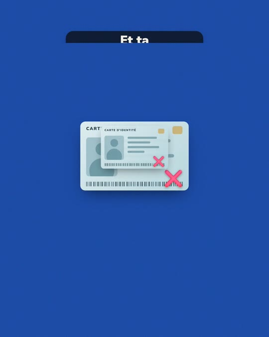

# Espace promo

Vidéos de présentation des logiciels d'**Anthony BELKACEM EI**, prêtes à publier sur LinkedIn.

Des logiciels simples, sans compte et sans cloud, pour protéger ses documents et gérer ses outils au quotidien.

## Filigo

**Filigo** filigrane vos copies de documents sensibles (carte d'identité, justificatifs, quittances) : chaque copie porte le nom du destinataire, le motif et la date, 100 % en local. Téléchargement et code : [Filigo-apps](https://github.com/Gitnmercury/Filigo-apps).

| | |
|---|---|
|  |  |
| **Vidéo A : le compteur** Les chiffres de l'usurpation d'identité (source CNIL), puis la réponse : filigraner chaque copie. 35 s, 25 Mo [Voir la vidéo](Filigo/Filigo_A_LinkedIn_4x5.mp4) | **Vidéo B : l'histoire** Le trajet d'une carte d'identité envoyée par mail, de l'agence à l'inconnu, jusqu'à un crédit à ton nom. Voix off, sous-titres et musique. 27 s, 20 Mo [Voir la vidéo](Filigo/Filigo_B_LinkedIn_4x5.mp4) |

### Caractéristiques

- Format 4:5 (1080 x 1350), 25 images par seconde
- Vidéo H.264, son AAC, sous-titres incrustés
- Compatibles lecture directe dans le navigateur et publication LinkedIn

## Réutilisation

Ces vidéos peuvent être partagées librement, avec crédit à **Anthony BELKACEM EI**. Toute vente ou réutilisation commerciale nécessite un accord écrit.

© 2026 Anthony BELKACEM EI. Contact : apps@ohtna.fr
